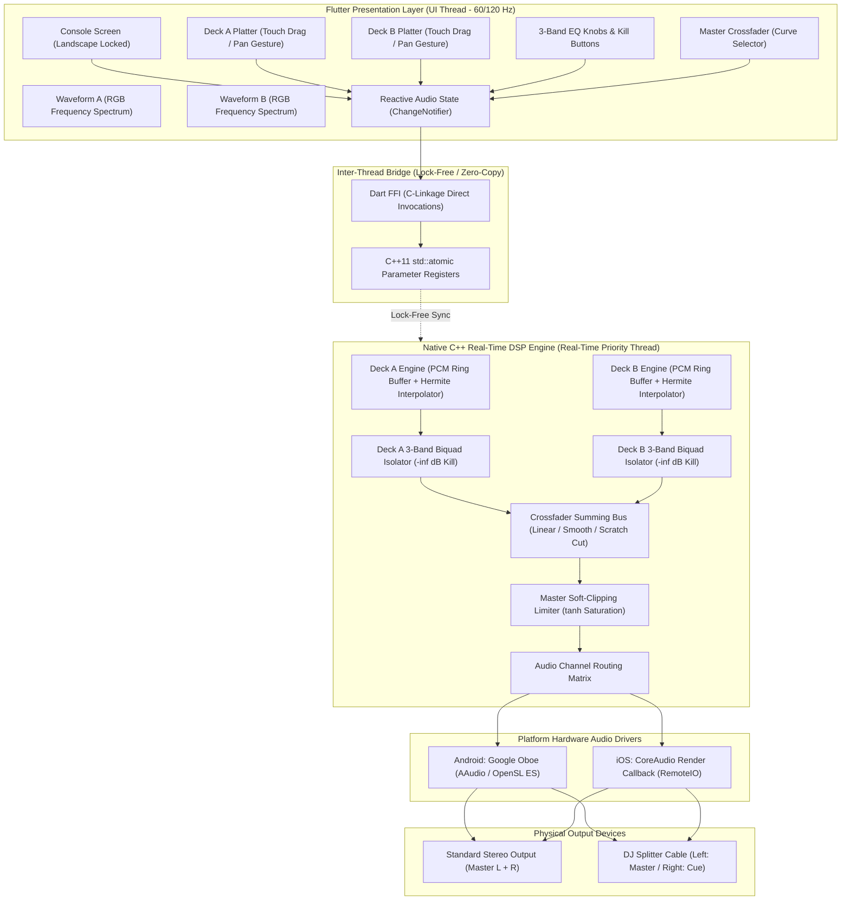
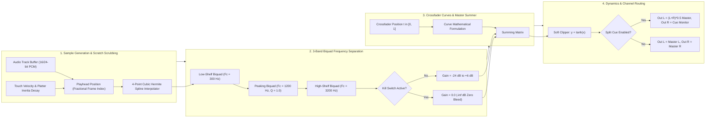

# DJ Console Mobile (Cross-Platform / Flutter + C++ Core)

A professional, ultra-low-latency 2-Deck Mobile DJ Console engineered for iOS and Android, targeting production release on the Apple App Store and Google Play Store.

---

## 1. High-Level System Design (HLD)

Building a live performance DJ console on mobile operating systems presents a unique engineering challenge: **the UI thread and the audio processing thread must be completely decoupled.** 

If audio DSP runs in the UI runtime (Dart or Java), garbage collection (GC) pauses introduce jitter and buffer underruns—heard as audible pops, clicks, or dropouts. Furthermore, vinyl scratching demands **<10–15ms touch-to-sound latency**, which is impossible with standard high-level media players that buffer 100ms+ ahead.

### System Topology Architecture



---

## 2. Real-Time DSP Signal Flow

The audio callback is invoked by the platform audio hardware at fixed buffer intervals (typically 256 or 512 frames at 44.1 kHz / 48.0 kHz, corresponding to ~5.8ms to 11.6ms chunks).



---

## 3. Core Architectural Subsystems

### A. Low-Latency Vinyl Scratching Physics
1. **Touch to Angular Displacement**:
   * 1 full turntable revolution ($2\pi$ radians) corresponds to 1.8 seconds of audio at standard 33.3 RPM playback.
   * Pan gestures compute angular deltas $\Delta\theta$ around the jogwheel center with boundary wrap-around protection:
     $$\Delta\theta = \text{atan2}(y_2 - c_y, x_2 - c_x) - \text{atan2}(y_1 - c_y, x_1 - c_x)$$
2. **Platter Inertia & Friction Decay**:
   * While touching: Playback speed strictly follows finger rotational velocity.
   * On release: The platter preserves momentum with an exponential friction decay:
     $$\text{velocity}_{t+1} = \text{velocity}_t \times 0.92$$
   * When $|\text{velocity}| < 0.02$, inertia terminates and smoothly hands back to the pitch fader's rate.
3. **Hermite Cubic Spline Interpolation**:
   * Scrubbing audio at arbitrary speeds requires non-integer sample reading. Linear interpolation introduces high-frequency aliasing distortion; we use 4-point Hermite cubic splines:
     $$\text{sample} = (((a \cdot \mu + b) \cdot \mu + c) \cdot \mu) + y_1$$

### B. 3-Band Biquad Isolator EQ & Kill Switches
* **Low Shelf Filter**: $F_c = 300\text{ Hz}$, $Q = \frac{\sqrt{2}}{2}$
* **Mid Peaking Filter**: $F_c = 1200\text{ Hz}$, $Q = 1.0$
* **High Shelf Filter**: $F_c = 3200\text{ Hz}$, $Q = \frac{\sqrt{2}}{2}$
* **Kill Switches**: Hard-zeroed ($0.0\times$ linear multiplier) to guarantee true $-\infty\text{ dB}$ silence on cut mixing.

### C. Mathematical Crossfader Curves
* **Linear**: $G_A = 1 - t$, $G_B = t$ (Produces a -6dB dip at center for clean transitions).
* **Constant Power Smooth**: $G_A = \cos(\frac{\pi}{2} t)$, $G_B = \sin(\frac{\pi}{2} t)$ (Preserves flat $0\text{ dB}$ energy sum: $G_A^2 + G_B^2 = 1.0$).
* **Sharp Scratch Cut**: Exponential response with $<5\%$ cut-in travel threshold for instant hip-hop scratching.

### D. Audio Routing & Pre-Cueing Architecture
A DJ needs to preview the incoming track in headphones while the crowd hears the master mix. On mobile devices with a single 3.5mm jack or USB-C DAC, the engine supports **Mono-Split Mode**:
* **Channel Left**: Master mix ($(\text{Deck A} + \text{Deck B}) \times \text{Crossfader}$).
* **Channel Right**: Headphone cue mix (Cued deck at 100% volume).
* Connects directly to commercial DJ splitter cables (separating Left to Speakers and Right to Headphones).

---

## 4. Technical Specifications Summary

| Component | Technical Specification |
| :--- | :--- |
| **Audio Core** | C++17 real-time DSP bus with zero memory allocations inside the audio callback |
| **Target Latency** | Touch-to-sound latency $< 15\text{ ms}$ |
| **Audio Drivers** | Android: Google Oboe (AAudio + OpenSL ES fallback); iOS: CoreAudio Render Callback |
| **EQ Architecture** | 3-Band Biquad Isolator (300Hz / 1.2kHz / 3.2kHz) with $-\infty\text{ dB}$ Kill switches |
| **Crossfader Curves** | Linear blend, Constant-Power smooth mix, and Sharp Scratch Cut (<5% cut-in lag) |
| **Waveform Engine** | 60/120 FPS 3-Band RGB Spectrum (Red: Bass <250Hz, Green: Mids 250Hz-3kHz, Blue: Highs >3kHz) |
| **Pre-Cueing Support** | Mono-Split Mode (Channel L = Master Out, Channel R = Headphone Monitor) |

---

## 5. Test Suite & Verification Matrix

The repository includes a comprehensive, automated test suite spanning DSP math, state management, and UI widgets:

| Test ID | Category | Target | Verification Goal | File |
| :--- | :--- | :--- | :--- | :--- |
| **TC-XF-01** | DSP Math | Crossfader Linear | $t=0 \to (1,0)$, $t=0.5 \to (0.5,0.5)$, $t=1 \to (0,1)$ | `test/dsp_math_test.js` & `.dart` |
| **TC-XF-02** | DSP Math | Constant Power | Flat $0\text{ dB}$ energy sum ($G_A^2 + G_B^2 = 1.0$) across full sweep | `test/dsp_math_test.js` & `.dart` |
| **TC-XF-03** | DSP Math | Scratch Cut | Cut-in lag $<5\%$ travel, achieving $100\%$ volume immediately | `test/dsp_math_test.js` & `.dart` |
| **TC-INT-01** | Interpolation | Hermite Spline | Exact boundary convergence at $\mu=0$ and $\mu=1$ | `test/dsp_math_test.js` & `.dart` |
| **TC-INT-02** | Interpolation | Spline Monotonicity | Midpoint values bounded without overshoot | `test/dsp_math_test.js` & `.dart` |
| **TC-EQ-01** | DSP Filter | 3-Band Isolator | Kill switches produce true zero-bleed ($-\infty\text{ dB}$) | `test/dsp_math_test.js` |
| **TC-SCR-01** | Scratch Physics | Platter Inertia | Friction decay strictly monotonic ($\text{velocity} \times 0.92$) | `test/dsp_math_test.js` |
| **TC-ST-01** | State Machine | Initialization | 2 decks initialized with demo tracks loaded, transport stopped | `test/audio_state_test.dart` |
| **TC-ST-02** | State Machine | Play / Pause | Deck toggles playing state and triggers audio engine | `test/audio_state_test.dart` |
| **TC-ST-03** | State Machine | Cue Reset | Cue stops deck and rewinds playhead to 0 | `test/audio_state_test.dart` |
| **TC-ST-04** | State Machine | Pitch Clamping | Pitch fader bounded to $[-16\%, +16\%]$ | `test/audio_state_test.dart` |
| **TC-ST-05** | State Machine | 3-Band EQ & Kills | Gains set correctly and kill flags toggle with state notification | `test/audio_state_test.dart` |
| **TC-ST-06** | State Machine | Crossfader Range | Position clamped to $[-1.0, +1.0]$ and curve mode persists | `test/audio_state_test.dart` |
| **TC-ST-07** | State Machine | Split-Cue Toggle | Toggles mono-split cue routing for DJ headphone splitter | `test/audio_state_test.dart` |
| **TC-UI-01** | Flutter Widget | ConsoleScreen | Dual decks, transport buttons, scrolling waveforms, and fader render cleanly | `test/widget_test.dart` |

### Running the Test Suites

```bash
# 1. Run DSP Math Regression Tests (Runs in any terminal with Node.js)
node test/dsp_math_test.js

# 2. Run C++ Compiler Verification
clang++ -std=c++17 -c native/src/dj_engine.cpp -I native/include -o /dev/null

# 3. Run Flutter & Dart Unit/Widget Tests (When Flutter SDK is installed)
flutter test test/dsp_math_test.dart
flutter test test/audio_state_test.dart
flutter test test/widget_test.dart
```

---

## 6. Directory Structure

```
DJ Console/
├── README.md                      # High-Level Architecture & System Design
├── AUDIT.md                       # Quality, latency, and DSP mathematical audits
├── SESSIONHANDOFF.md              # Milestones, operational state & AI credit ledger
├── pubspec.yaml                   # Flutter package dependencies
├── .agents/
│   └── skills/                    # Antigravity skill runbooks
│       ├── dj-audio-dsp/SKILL.md
│       ├── dj-scratch-physics/SKILL.md
│       └── dj-store-release/SKILL.md
├── agents/                        # Autonomous agent role specifications
│   ├── dj_arch_agent.md           # Architecture Agent
│   ├── dj_dev_agent.md            # Development Agent
│   ├── dj_qa_agent.md             # Test & QA Agent
│   └── dj_release_agent.md        # Pipeline Release Agent
├── lib/
│   ├── main.dart                  # Landscape-locked mobile DJ entrypoint
│   ├── core/
│   │   ├── audio_engine_ffi.dart  # Dart FFI bindings to C++ audio engine
│   │   ├── dsp_math.dart          # DSP math & curve models (Dart mirror)
│   │   ├── audio_state.dart       # Reactive 2-deck state management
│   │   └── track_model.dart       # Track metadata & waveform peak models
│   └── ui/
│       ├── console_screen.dart    # Main DJ Console UI layout
│       └── widgets/
│           ├── deck_widget.dart       # Deck container (A & B)
│           ├── jogwheel_widget.dart   # Interactive scratch jogwheel
│           ├── waveform_widget.dart   # RGB frequency scrolling waveform
│           ├── eq_strip_widget.dart   # 3-Band EQ & Gain knobs + Kill switches
│           └── crossfader_widget.dart # Crossfader slider with curve selector
├── native/
│   ├── CMakeLists.txt             # Android NDK / Desktop C++ build configuration
│   ├── include/
│   │   └── dj_engine.h            # C-linkage API exported to Dart FFI
│   └── src/
│       ├── dj_engine.cpp          # Engine lifecycle, mixing bus, and audio callback
│       ├── deck.cpp               # Audio playback, seek, and scratch interpolation
│       ├── biquad_eq.cpp          # 3-band isolator biquad filters
│       └── crossfader.cpp         # Crossfader curve calculations
├── test/
│   ├── README.md                  # Test suite documentation & verification matrix
│   ├── dsp_math_test.js           # Automated test suite for DSP math and curves
│   ├── dsp_math_test.dart         # Dart unit test suite for DSP math
│   ├── audio_state_test.dart      # Dart unit test suite for state transitions
│   └── widget_test.dart           # Flutter UI widget test suite
├── web_preview/
│   └── index.html                 # In-browser interactive 2-Deck DJ testbed
├── fastlane/
│   └── Fastfile                   # Mobile build & release automation
└── .github/
    └── workflows/
        └── ci_cd.yml              # GitHub Actions CI/CD pipeline
```

---

## 7. Multi-Agent Operating Model

This codebase is governed by 4 specialized autonomous agents configured to collaborate across the software development lifecycle:
* [**`dj_arch_agent`**](agents/dj_arch_agent.md): System architecture, DSP algorithms, thread safety, and ADRs.
* [**`dj_dev_agent`**](agents/dj_dev_agent.md): Flutter UI widgets, C++ audio engine, and FFI integration.
* [**`dj_qa_agent`**](agents/dj_qa_agent.md): DSP mathematical verification, test execution, and [`AUDIT.md`](AUDIT.md).
* [**`dj_release_agent`**](agents/dj_release_agent.md): CI/CD pipelines, mobile store compliance, and [`SESSIONHANDOFF.md`](SESSIONHANDOFF.md).
